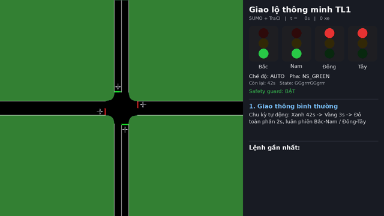

# Khảo sát, xây dựng hệ thống giao thông thông minh bằng SUMO


Mô phỏng một giao lộ 4 hướng (Bắc–Nam–Đông–Tây) có đèn tín hiệu tự động bằng
[Eclipse SUMO](https://eclipse.dev/sumo/), điều khiển đèn từ Python qua TraCI và có cổng
nhận lệnh từ bên ngoài (`set_traffic_light("TL1","GREEN",30)`) để sau này nối với **Agent Guard**.



Video demo đầy đủ (2 phút 25 giây): [`media/demo.mp4`](media/demo.mp4)

## Kiến trúc

```
 network/*.nod.xml + *.edg.xml ──netconvert──► network/intersection.net.xml (giao lộ TL1)
 routes/intersection.rou.xml        (36 xe, 6 loại)            │
 routes/intersection.tls.add.xml    (chu kỳ đèn chỉnh được) ────┴─► intersection.sumocfg ─► SUMO / SUMO-GUI
                                                                                             ▲
                                                                                  TraCI (socket)
                                                                                             │
   Agent Guard / send_command.py ──TCP:9000──► command_interface.py ──► safety_guard.py ──► tls_control.py
   (lệnh dạng văn bản / JSON)                   (phân tích lệnh an toàn)   (chặn lệnh nguy hiểm)  (đọc / ghi đèn)
                                                         ▲
                              scenarios.py (normal / extended_green / dangerous / emergency / demo)
                              run_simulation.py (CLI) · check_requirements.py (tự kiểm tra) · record_demo.py (video)
```

## Cài đặt

```bash
pip install eclipse-sumo traci sumolib pillow
sumo --version
```

## Chạy nhanh

```bash
# Tự kiểm tra các yêu cầu 1-9 (in bảng ĐẠT / KHÔNG ĐẠT)
python scripts/check_requirements.py

# 3 tình huống bắt buộc (+ 1 tình huống xe cứu thương)
python scripts/run_simulation.py --scenario normal
python scripts/run_simulation.py --scenario extended_green
python scripts/run_simulation.py --scenario dangerous             # guard chặn lệnh nguy hiểm
python scripts/run_simulation.py --scenario dangerous --unsafe    # tắt guard để thấy hậu quả
python scripts/run_simulation.py --scenario emergency --gui

# Nhận lệnh từ bên ngoài (Agent Guard) — cửa sổ 1:
python scripts/run_simulation.py --scenario interactive --gui
#                                     — cửa sổ 2:
python scripts/send_command.py "set_traffic_light('TL1','GREEN',30)"

# Quay lại video + ảnh demo (cần ffmpeg)
python scripts/record_demo.py
```

## Cấu trúc thư mục

| File | Vai trò |
|---|---|
| `network/intersection.nod.xml`, `.edg.xml` | 5 nút (TL1 + N/S/E/W), 8 cạnh vào/ra, mỗi nhánh 200 m |
| `network/intersection.net.xml` | Mạng đã biên dịch bằng `netconvert --no-turnarounds` |
| `routes/intersection.rou.xml` | 12 luồng (mọi cặp hướng) × 3 xe = **36 xe**, 6 loại xe, đến ngẫu nhiên (Poisson) |
| `routes/intersection_light.rou.xml` | Cùng 36 xe nhưng dồn vào ~4 phút — dùng khi xem GUI / quay video |
| `routes/intersection.tls.add.xml` | Chương trình đèn chỉnh được: Xanh 42s → Vàng 3s → Đỏ toàn phần 2s (×2 hướng) |
| `scripts/tls_control.py` | Đọc trạng thái đèn, `set_traffic_light`, `extend_current_phase`, `set_cycle`, `set_state` |
| `scripts/command_interface.py` | Phân tích lệnh văn bản / JSON, máy chủ TCP nhận lệnh, chỗ gắn validator của Agent Guard |
| `scripts/safety_guard.py` | Kiểm tra an toàn tối thiểu: chặn xung đột xanh, chặn Xanh→Đỏ đột ngột |
| `scripts/scenarios.py` | Các tình huống minh họa + vòng lặp mô phỏng |
| `scripts/run_simulation.py` | CLI chạy mô phỏng |
| `scripts/send_command.py` | Client mẫu gửi lệnh qua TCP (giả lập Agent Guard) |
| `scripts/check_requirements.py` | Tự kiểm tra yêu cầu 1–9 |
| `scripts/record_demo.py` | Quay video `media/demo.mp4`, `demo.gif` và 8 ảnh mốc |

## Tiến độ 10 yêu cầu

| # | Yêu cầu | Trạng thái | Minh chứng |
|---|---------|-----------|-----------|
| 1 | Cài đặt, chạy SUMO/SUMO-GUI | ✅ | `check_requirements.py`, video quay từ SUMO-GUI |
| 2 | 01 giao lộ 4 hướng B–N–Đ–T | ✅ | `network/` |
| 3 | 20–50 xe | ✅ | 36 xe (cố định bằng `number="3"`), +1 xe cứu thương ở kịch bản emergency |
| 4 | Đèn Đỏ–Vàng–Xanh tự động | ✅ | `intersection.tls.add.xml` |
| 5 | Thay đổi chu kỳ / thời gian đèn | ✅ | sửa XML, `extend_current_phase()`, `set_cycle()` |
| 6 | Python + TraCI đọc trạng thái đèn | ✅ | `get_traffic_light_state()` |
| 7 | Python gửi lệnh đổi trạng thái / thời gian đèn | ✅ | `set_traffic_light()`, `extend_current_phase()` |
| 8 | 3 tình huống: bình thường, tăng xanh, lệnh nguy hiểm | ✅ | `normal`, `extended_green`, `dangerous` (+ `emergency`) |
| 9 | Nhận lệnh `set_traffic_light("TL1","GREEN",30)` từ bên ngoài | ✅ | `command_interface.py` + TCP :9000 |
| 10 | Báo cáo, source, ảnh, video 2–3 phút | ✅ | `REPORT.md`, `media/` |

Chi tiết: [REPORT.md](REPORT.md) · Hướng dẫn: [HUONG_DAN_SU_DUNG.md](HUONG_DAN_SU_DUNG.md) ·
Các lệnh điều khiển đèn: [HUONG_DAN_CHE_DO_DEN.md](HUONG_DAN_CHE_DO_DEN.md) · Lịch sử: [PROGRESS.md](PROGRESS.md)
